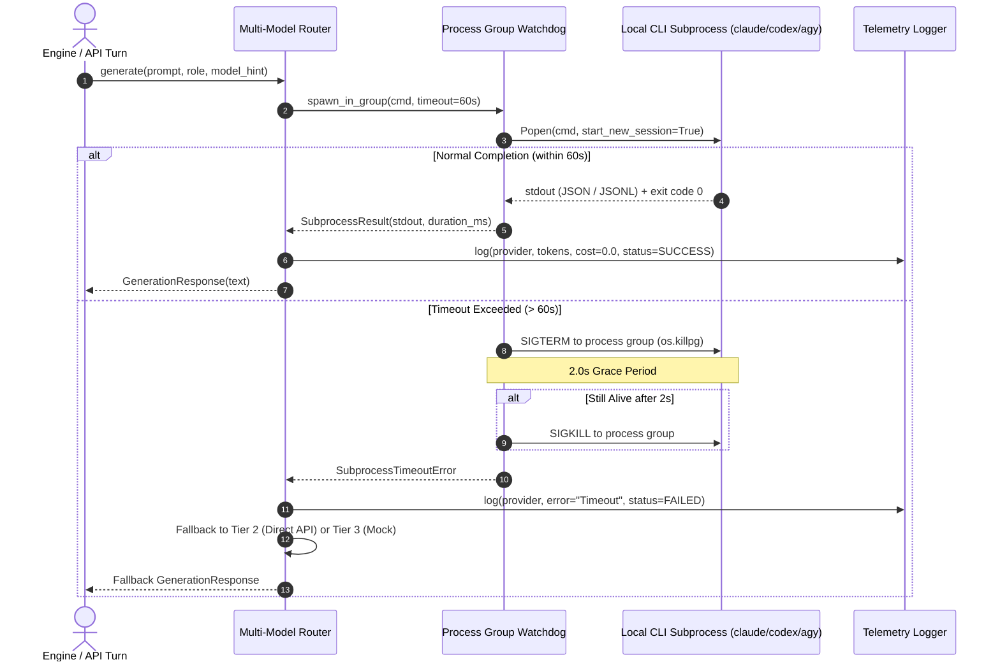
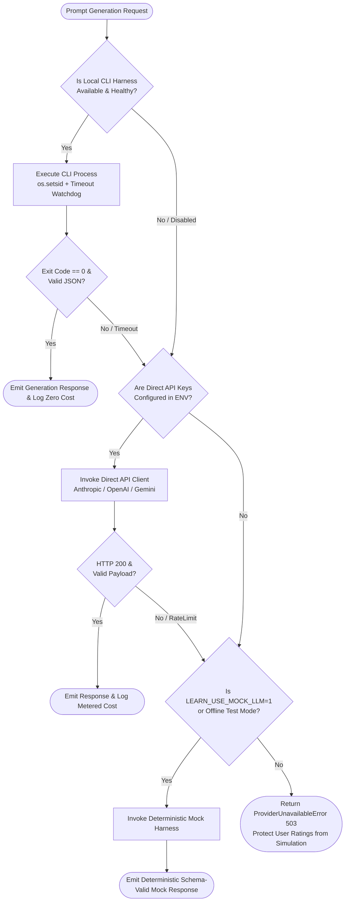
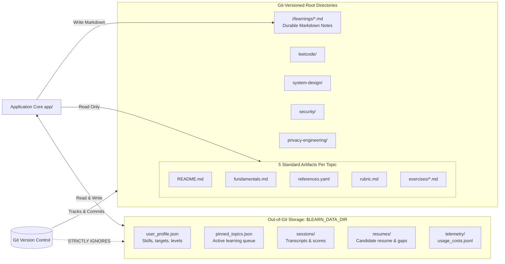
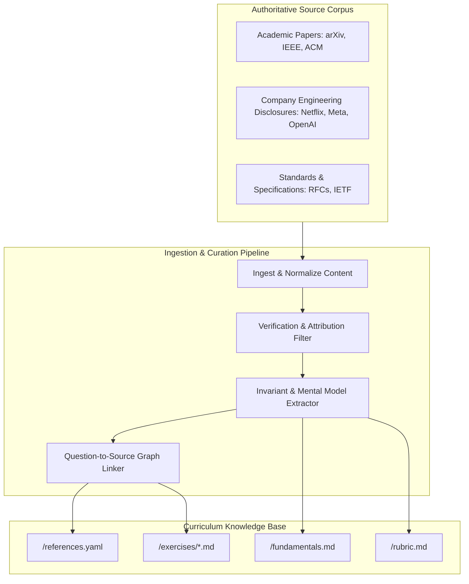
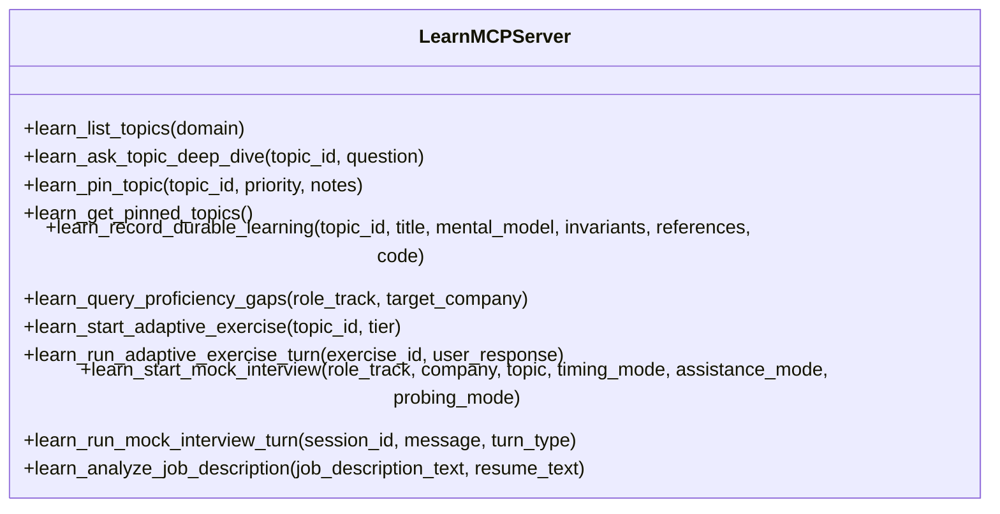

# System Architecture: Savage-Fred/learn

**Document Version**: 1.0.0  
**Target Milestone**: Milestone 1 (Foundation PR)  
**Author**: Savage-Fred Architecture Subagent  
**Repository**: `Savage-Fred/learn`  
**Classification**: Authoritative Technical Architecture  

---

## 1. Executive Summary & Architectural Invariants

`Savage-Fred/learn` is a local-first, Tailnet-reachable technical learning and L4–L6 interview preparation platform. It orchestrates Gemini, ChatGPT/Codex, and Claude using a hybrid subscription-first execution architecture (invoking installed local CLI harnesses `claude`, `codex`, and `agy` alongside an MCP server and custom harness plugins/skills, with optional direct API-key fallback and deterministic mock execution).

### 1.1 Core Architectural Invariants

1. **Strict Application & Domain Separation**:  
   The application platform code resides strictly in `app/`. Pedagogical knowledge domains reside in dedicated root directories (`leetcode/`, `system-design/`, `security/`, `privacy-engineering/`). No domain learning content may be hardcoded into `app/`, and no application runtime code may live in root domain directories.
2. **Dual Storage Boundary (The Clean-Tree Invariant)**:  
   All persistent pedagogical content (curricula, invariants, references, rubrics, problem sets, and distilled durable learnings) is Git-versioned in the repository root. All personal user state (subdomain ratings, interview transcripts, quiz history, scorecards, resume markdown, and cost telemetry) is persisted strictly outside of Git in an XDG data directory (`$LEARN_DATA_DIR` or `~/.local/share/learn/`). Automated tests assert that `git status --porcelain` remains clean after any user session.
3. **Subscription-First, Zero-Cost Default**:  
   All LLM inference prioritizes active user subscriptions by invoking local CLI harnesses (`claude`, `codex`, `agy`) via headless non-interactive commands. Direct API key access serves as secondary fallback, and a deterministic offline mock harness serves automated testing and offline operation.
4. **Subprocess Isolation & Process Group Hygiene**:  
   CLI harnesses run in isolated OS process groups (`os.setsid`). Any process execution that times out or is cancelled receives `SIGTERM`, waits a 2-second grace period, and escalates to `SIGKILL` across the entire process group, eliminating runaway subprocesses.
5. **Local-First & Tailnet Mesh Reachability**:  
   The server binds to `0.0.0.0` or `127.0.0.1` on configurable port `8795` (or `$LEARN_PORT`), exposing a responsive Web UI and SSE MCP endpoint accessible locally and over the Tailscale mesh network (`100.64.162.123:8795` or `will-ubuntu-26.tailacca87.ts.net:8795`).

---

## 2. System Overview & Component Topography

The system comprises three primary planes: the **Client & Interface Plane**, the **Application Core Plane** (`app/`), and the **Dual Storage Plane**.

```mermaid
graph TB
    subgraph ClientPlane [Client & Interface Plane]
        WebClient["Web UI (Desktop / Mobile Browser)<br/>Tailnet: 100.64.162.123:8795<br/>Local: localhost:8795"]
        ClaudeClient["Claude Code CLI<br/>(via stdio plugin)"]
        CodexClient["Codex CLI (Astra/Sol)<br/>(via config.toml stdio)"]
        AgyClient["Antigravity / Gemini CLI<br/>(via custom MCP schema)"]
    end

    subgraph AppPlane [Application Core Plane (app/)]
        subgraph ServerLayer [Server & Ingress Layer]
            FastAPI["FastAPI App (app/main.py)<br/>REST APIs & WebSockets"]
            MCPServer["MCP Server (app/mcp/server.py)<br/>JSON-RPC 2.0 (stdio & SSE)"]
            StaticServe["Static File Server (app/ui/)<br/>HTML5 / Vanilla JS / CSS"]
        end

        subgraph EngineLayer [Core Execution Engines (app/core/)]
            AdaptiveEng["Adaptive Exercise Engine<br/>(Dynamic Difficulty Ladder)"]
            InterviewEng["Mock Interview Engine<br/>(Hints & No-Hints Modes)"]
            ResumeEng["Role & Resume Matcher<br/>(Gap Analysis & Loop Planner)"]
            DurableEng["Durable Learning Capture<br/>(Rabbit-Hole Distillation)"]
            TopicLoader["Topic Loader & Validator<br/>(Root Directory Parser)"]
        end

        subgraph RouterLayer [Multi-Model Router (app/router/)]
            MMRouter["Multi-Model Router<br/>(Tier Dispatcher & Watchdog)"]
            ProcMgr["Process Group Manager<br/>(os.setsid / SIGTERM / SIGKILL)"]
            TelemetryMgr["Cost & Usage Telemetry<br/>(Tokens, Latency, USD)"]
            
            subgraph Harnesses [Execution Harnesses]
                ClaudeHarness["Claude Harness<br/>claude -p"]
                CodexHarness["Codex Harness<br/>codex exec (Astra/Sol)"]
                AgyHarness["Antigravity Harness<br/>agy --print"]
                ApiFallback["Direct API Fallback<br/>(Anthropic, OpenAI, Gemini)"]
                MockHarness["Deterministic Mock<br/>(Offline / Unit Tests)"]
            end
        end
    end

    subgraph StoragePlane [Dual Storage Plane]
        subgraph GitTracked [Git-Versioned Knowledge (Repo Root)]
            LeetcodeDir["leetcode/<br/>pythonic, algorithms, data-structures"]
            SysDesignDir["system-design/<br/>statistics, rust, go"]
            SecurityDir["security/<br/>authn-authz, threat-modeling, agent-access"]
            PrivacyDir["privacy-engineering/<br/>pets-for-ai, differential-privacy"]
            DurableOut["<domain>/<topic>/learnings/<br/>*.md durable capture files"]
        end

        subgraph OutOfGit [Out-of-Git Personal State ($LEARN_DATA_DIR)]
            UserProfile["user_profile.json<br/>(Subdomain ratings, target roles)"]
            PinsStore["pinned_topics.json<br/>(Priority pins & notes)"]
            SessionsStore["sessions/<br/>(Quiz & interview transcripts)"]
            ResumesStore["resumes/<br/>(active_resume.md & gap reports)"]
            TelemetryStore["telemetry/<br/>usage_costs.jsonl"]
        end
    end

    %% Client Ingress
    WebClient -->|HTTP / WebSocket| FastAPI
    WebClient -->|Static Assets| StaticServe
    ClaudeClient -->|stdio JSON-RPC| MCPServer
    CodexClient -->|stdio JSON-RPC| MCPServer
    AgyClient -->|stdio / JSON-RPC| MCPServer
    WebClient -.->|SSE JSON-RPC| MCPServer

    %% Ingress to Engines
    FastAPI --> EngineLayer
    MCPServer --> EngineLayer

    %% Engines to Subsystems
    EngineLayer --> TopicLoader
    EngineLayer --> MMRouter
    EngineLayer --> OutOfGit

    TopicLoader --> GitTracked
    DurableEng -->|Commit Markdown| DurableOut

    %% Router to Harnesses
    MMRouter --> ProcMgr
    MMRouter --> TelemetryMgr
    ProcMgr --> ClaudeHarness
    ProcMgr --> CodexHarness
    ProcMgr --> AgyHarness
    MMRouter --> ApiFallback
    MMRouter --> MockHarness

    TelemetryMgr --> TelemetryStore
```

---

## 3. Client Layer Architecture

The client layer supports dual consumption models: human interaction via a modern browser UI, and autonomous agent interaction via the Model Context Protocol (MCP).

### 3.1 Web UI (Desktop & Mobile Browser)
- **Deployment & Access**: Served directly by the FastAPI backend at port `8795`. Accessible via loopback (`http://127.0.0.1:8795`) and across the Tailscale mesh network (`http://100.64.162.123:8795` or `https://will-ubuntu-26.tailacca87.ts.net:8795`).
- **Technology Stack**: Native ES Modules, vanilla JavaScript, modern semantic HTML5, and responsive CSS (Tailwind or custom CSS tokens). Eliminates fragile JavaScript build tooling and node_modules bloat in development.
- **Real-Time Communication**:
  - **REST API** (`/api/v1/*`): CRUD operations on topics, pins, profiles, and resume gap analyses.
  - **WebSocket** (`/ws/interview/{session_id}`): Low-latency bidirectional streaming for interactive mock interview turns and adaptive quiz dialogue.

### 3.2 MCP Clients (Agentic Integrations)
- **Claude Code**: Integrates via stdio transport using `.claude-plugin/` and `.mcp.json`. Exposes all 8 Learn tools during interactive command-line engineering sessions.
- **Codex CLI**: Configured via `~/.codex/config.toml` under `[mcp_servers.learn]`. Allows Astra (`gpt-6-astra`) and Sol (`gpt-6-sol`) to query user ratings, run interviews, or record durable learnings.
- **Antigravity CLI**: Configured via `~/.gemini/antigravity-cli/mcp/learn/` exposing JSON schemas and tool definitions.
- **Network / Remote MCP**: Fast-flowing SSE endpoint at `/mcp/sse` enables remote AI agents across the Tailnet to invoke platform tools over HTTP streaming.

---

## 4. Application Core Architecture (`app/`)

The application core is structured as a modular Python package adhering to strict separation of concerns.

### 4.1 Module Organization

```
app/
├── __init__.py
├── main.py                     # Application entry point, CLI parser, Uvicorn launcher
├── config.py                   # Pydantic Settings: host, port, paths, XDG resolution
├── api/                        # REST & WebSocket API Routers
│   ├── __init__.py
│   ├── routes_topics.py        # /api/v1/topics (list, get, pin, durable capture)
│   ├── routes_exercises.py     # /api/v1/exercises (adaptive quiz progression)
│   ├── routes_interviews.py    # /api/v1/interviews (mock interview lifecycle)
│   ├── routes_roles.py         # /api/v1/roles (resume & gap matching)
│   └── routes_telemetry.py    # /api/v1/telemetry (token & cost reports)
├── core/                       # Domain Business Logic
│   ├── __init__.py
│   ├── adaptive_engine.py      # Difficulty stepping algorithm (Elo-based)
│   ├── interview_engine.py     # 5-phase interview state machine & rubric evaluator
│   ├── resume_matcher.py       # Role competency delta & loop generator
│   ├── durable_capture.py      # Markdown synthesizer & frontmatter validator
│   └── topic_loader.py         # Root directory curriculum scanner
├── router/                     # Multi-Model LLM Routing Subsystem
│   ├── __init__.py
│   ├── multi_model_router.py   # MultiModelRouter dispatcher & fallback logic
│   ├── process_manager.py      # Process group isolation & SIGTERM/SIGKILL escalation
│   ├── telemetry.py            # TelemetryLogger & cost calculation
│   └── harnesses/              # Concrete execution harness implementations
│       ├── __init__.py
│       ├── base.py             # BaseLLMHarness abstract interface & DTOs
│       ├── claude_harness.py   # Subprocess wrapper for `claude -p`
│       ├── codex_harness.py    # Subprocess wrapper for `codex exec`
│       ├── agy_harness.py      # Subprocess wrapper for `agy -p`
│       ├── api_fallback.py     # Direct HTTP client for Anthropic/OpenAI/Gemini
│       └── mock_harness.py     # Deterministic mock harness for tests & offline CI
├── mcp/                        # Model Context Protocol Implementation
│   ├── __init__.py
│   ├── server.py               # JSON-RPC 2.0 stdio & SSE server implementation
│   ├── tools.py                # Tool declarations & Pydantic JSON schemas
│   └── handlers.py             # Tool invocation dispatchers
├── storage/                    # Out-of-Git Data Persistence
│   ├── __init__.py
│   └── personal_state.py       # XDG data directory file manager & JSON/JSONL store
├── ui/                         # Web Frontend Assets
│   ├── static/
│   │   ├── css/
│   │   ├── js/
│   │   └── img/
│   └── templates/
│       └── index.html
└── tests/                      # Automated Test Suite
    ├── conftest.py             # Fixtures (isolated test data dir, mock router)
    ├── test_router.py          # Unit tests for CLI harnesses & fallback
    ├── test_mcp.py             # Integration tests for 8 MCP tools
    ├── test_storage.py         # Tests verifying out-of-git state isolation
    ├── test_engines.py         # Adaptive, interview, and resume engine tests
    └── test_clean_repo.py      # Assertion that git status --porcelain is clean
```

### 4.2 Core Execution Engines

#### 1. Adaptive Exercise Engine (`app/core/adaptive_engine.py`)
- **Progression Logic**: Implements an Elo-derived difficulty stepping algorithm calibrated across 4 tiers:
  - `Tier 1 (Starter)`: Basic syntax, conceptual invariants.
  - `Tier 2 (Intermediate / L4)`: Standard algorithmic implementation, single-host constraints.
  - `Tier 3 (Advanced / L5)`: Edge cases, concurrency, distributed failure modes.
  - `Tier 4 (Staff / L6)`: Ambiguous requirements, system-level trade-offs, catastrophic failure mitigation.
- **Dynamic Stepping**:
  - Score $\ge 4.0$ (out of 5.0): Level up. Next question introduces stricter constraints (e.g., $O(1)$ auxiliary space, Byzantine faults, lock-free concurrency).
  - Score $< 4.0$: Level down or scaffold. Next turn generates a guided sub-problem focusing on the specific invariant failed.

#### 2. Mock Interview Engine (`app/core/interview_engine.py`)
- **Phase State Machine**: Clarification $\to$ High-Level Approach $\to$ Implementation $\to$ Verification & Edge Cases $\to$ Interviewer Probing / Follow-Ups.
- **Modes**:
  - `hints`: Socratic partner mode. Progressive 3-level hints: Level 1 (Conceptual prompt), Level 2 (Structural pattern), Level 3 (Pseudocode scaffold).
  - `no-hints`: Strict simulation. Timed (45 min coding, 60 min system design), no unprompted assistance, active adversarial stress probing (100x scale, dropped packets, memory starvation).
- **Evaluation Rubric**: 5 standardized dimensions scored 1–5:
  1. *Decomposition & Framing*
  2. *Technical Execution & Correctness*
  3. *Architecture & Scaling Trade-offs*
  4. *Resilience, Failure Modes & Edge Cases*
  5. *Communication, Synthesis & Signal*

#### 3. Role & Resume Matcher (`app/core/resume_matcher.py`)
- **Calibration Engine**: Evaluates candidate proficiency against target matrices across 4 tracks:
  1. FAANG SWE + AI Lab SWE (L5/L6 Senior/Staff)
  2. FAANG Privacy Engineer + AI Labs (L6 Staff)
  3. FAANG + AI Labs Security Engineer (L4–L6)
  4. AI Lab Research Engineer, non-PhD (L4–L5)
  Calibrated against 7 company bars: OpenAI, Google/GDM, Anthropic, Meta, Databricks, Netflix, and Apple.
- **Outputs**: Overall fit score (0–100%), ranked high-leverage skill gaps, customized 5-round mock interview loop, and recommended 30-day study trajectory.

#### 4. Durable Learning Capture (`app/core/durable_capture.py`)
- **Rabbit-Hole Distillation**: Synthesizes ad-hoc exploratory Q&A or interview debriefs into clean, permanent Markdown files.
- **Target Destination**: Committed directly into `<domain>/<topic_slug>/learnings/learn-YYYYMMDD-<slug>-<rand4>.md`.

---

## 5. Subscription-First Multi-Model Routing Subsystem

The multi-model router maximizes token efficiency and eliminates API fees by dispatching generation requests to local CLI harnesses backed by active user subscriptions.

### 5.1 Invocation Specification Matrix

| Provider | Harness Command | Output Format | Usage Extraction |
|---|---|---|---|
| **Claude Code** | `claude -p "<prompt>" --tools "" --output-format json --no-session-persistence` | JSON on stdout | `total_cost_usd`, `usage.input_tokens`, `usage.output_tokens`, `usage.cache_read_input_tokens` |
| **Codex CLI** | `codex exec --ephemeral --skip-git-repo-check -s read-only -c model="<model>" --json "<prompt>"` | JSONL events on stdout | `turn.completed.usage.input_tokens`, `output_tokens`, `reasoning_output_tokens` |
| **Antigravity CLI** | `agy --print "<prompt>" --output-format json --print-timeout 60s` | JSON on stdout | `usage.input_tokens`, `usage.output_tokens`, `usage.thinking_tokens` |

### 5.2 Process Group Lifecycle & Watchdog Management

To prevent hung subprocesses and lingering zombie agents:
1. **Creation**: Every subprocess is spawned using `start_new_session=True` (equivalent to `os.setsid` in POSIX). This places the spawned CLI and all child processes into a dedicated process group.
2. **Watchdog Timer**: An asynchronous watchdog enforces a strict execution deadline (default 60 seconds).
3. **Graceful Teardown (`SIGTERM`)**: On timeout or cancellation, `os.killpg(os.getpgid(proc.pid), signal.SIGTERM)` is issued to terminate the entire process group cleanly.
4. **Escalation (`SIGKILL`)**: If the process has not terminated after a 2.0-second grace window, `os.killpg(os.getpgid(proc.pid), signal.SIGKILL)` is executed.



### 5.3 3-Tier Fallback Hierarchy



1. **Tier 1 (Local Subscription CLI)**: Dispatches to `claude`, `codex`, or `agy`. Returns zero metered cost.
2. **Tier 2 (Direct API Key Fallback)**: If CLI binary is missing, unauthenticated, or fails repeatedly, falls back to direct HTTPS calls via `httpx` using `ANTHROPIC_API_KEY`, `OPENAI_API_KEY`, or `GEMINI_API_KEY`.
3. **Tier 3 (Deterministic Mock Harness)**: Activated strictly when `LEARN_USE_MOCK_LLM=1` or in explicit offline testing environments. In production mode, unexpected provider failures raise a `ProviderUnavailableError` (HTTP 503) rather than silently executing mock evaluations, preventing synthetic mock responses from corrupting verified user proficiency ratings or generating artificial hiring decisions.

### 5.4 Cost & Token Telemetry Schema

Every turn records a telemetry entry into `$LEARN_DATA_DIR/telemetry/usage_costs.jsonl`:

```json
{
  "telemetry_id": "0194e3b1-7a20-7210-9b41-f7619280d001",
  "timestamp": "2026-11-03T06:45:00.123Z",
  "provider": "claude",
  "model": "claude-sonnet-3-7",
  "execution_tier": "subscription_cli",
  "input_tokens": 1420,
  "output_tokens": 380,
  "cached_tokens": 850,
  "thinking_tokens": 0,
  "duration_ms": 2150,
  "estimated_cost_usd": 0.000000,
  "nominal_value_usd": 0.015240,
  "success": true,
  "error_message": null,
  "workflow_type": "adaptive_quiz"
}
```

---

## 6. Dual Storage Architecture & Persistence Models

A primary architectural foundation of `Savage-Fred/learn` is the strict bifurcation between public, team-sharable pedagogical curriculum files and private, ephemeral personal user performance state.



### 6.1 Git-Versioned Knowledge Plane

Curriculum content resides in dedicated top-level directories at the repository root, cleanly separated from the `app/` platform engine. The repository contains the 4 broad domain directories and the 11 dedicated priority topic directories:

1. **Broad Domains**:
   - `leetcode/`: General algorithmic paradigms and coding benchmarks.
   - `system-design/`: General systems architecture, scaling topologies, and failure modes.
   - `security/`: General security fundamentals, defense-in-depth, and perimeter security.
   - `privacy-engineering/`: General data protection, regulatory invariants, and compliance models.

2. **Dedicated Top-Level Priority Topic Roots**:
   - `pythonic-coding-patterns/`: Protocols, async generators, descriptors, and zero-copy optimization.
   - `masters-algorithms/`: Dynamic programming state space reduction, convex hull trick, network flow (Dinic), 2-SAT.
   - `data-structures/`: B+ Trees, lock-free ring buffers, cache-conscious structures, segment trees.
   - `modern-authn-authz/`: Zanzibar relationship-based access control (ReBAC), SPIFFE/SPIRE, OAuth2 token exchange.
   - `pets-for-ai/`: Confidential compute (TEEs, Nitro Enclaves, Apple PCC), SMPC, remote attestation.
   - `threat-modeling/`: STRIDE, PASTA, cloud trust boundaries, privilege escalation.
   - `agent-access-models/`: Least-privilege tool execution, sandboxed microVMs, prompt injection mitigation.
   - `statistics-for-data-analysis/`: Sequential testing, CUPED variance reduction, bootstrap estimation, latency percentiles.
   - `rust/`: Ownership, lifetimes, atomic memory ordering, unsafe invariants, FFI.
   - `go/`: GMP scheduler internals, channel synchronization, singleflight, memory model.
   - `modern-differential-privacy/`: (ε, δ)-DP composition bounds, DP-SGD, Moments Accountant, Rényi DP.

#### Durable Learning Markdown Standard & Privacy Redaction
When exploratory sessions or interview debriefs are distilled, the platform writes a structured Markdown note to `<topic_dir>/learnings/<id>.md`.
- **Pre-Save Redaction**: Prior to saving, the distillation engine scrubs candidate PII, candidate resume snippets, and company-confidential notes.
- **Write-Only Semantics**: The platform generates and writes the markdown file to disk for user review; the platform server NEVER executes autonomous git commits on the active branch.

```yaml
---
id: "learn-20261103-differential-privacy-k3b9"
title: "Renyi Differential Privacy for Iterative Gradient Sanitization"
topic: "modern-differential-privacy"
target_level: "L6"
invariants_covered:
  - "Rényi divergence order alpha privacy composition bounds"
  - "Subsampled Gaussian mechanism amplification"
citable_references:
  - "Mironov, I. (2017). Rényi Differential Privacy. IEEE CSF."
tags: ["differential-privacy", "deep-learning", "privacy-budget"]
created_at: "2026-11-03T06:48:12Z"
source_trigger: "on_demand_deep_dive"
---

# Renyi Differential Privacy for Iterative Gradient Sanitization

## 1. Core Intuition & Mental Model
...
```

### 6.2 Grounded Data Retrieval & Question Curation Architecture (§R2)

To satisfy Requirement §R2, all topic curricula, adaptive exercises, and mock interview problems are grounded in authoritative academic literature, engineering standards (RFCs), and public engineering disclosures.

> **Pedagogical Archetype Notice**: Mock interview loops and problem prompts represent calibrated practice archetypes derived from published engineering papers and public disclosures. Technical citations cite authoritative literature, while interview questions map to these foundational sources.



#### 6.2.1 Source Provenance Contract (`references.yaml`)
Every entry in a topic's `references.yaml` adheres to a strict machine-parsable schema with complete attribution and verification metadata:

```yaml
- source_id: "src-2017-mironov-rdp"
  title: "Rényi Differential Privacy"
  author_institution: "Ilya Mironov / Microsoft Research"
  publication_date: "2017-05-22"
  url: "https://arxiv.org/abs/1702.07476"
  retrieved_at: "2026-11-03T06:00:00Z"
  verification_status: "peer_reviewed" # peer_reviewed | company_verified | community_validated
  primary_topic: "modern-differential-privacy"
  target_levels: ["L5", "L6"]
  key_invariants_extracted:
    - "Rényi divergence order alpha privacy composition bounds"
    - "Subsampled Gaussian mechanism amplification"

- source_id: "src-2019-google-zanzibar"
  title: "Zanzibar: Google's Consistent, Global Authorization System"
  author_institution: "Ruoming Pang et al. / Google"
  publication_date: "2019-06-01"
  url: "https://research.google/pubs/pub48190/"
  retrieved_at: "2026-11-03T06:00:00Z"
  verification_status: "peer_reviewed"
  primary_topic: "modern-authn-authz"
  target_levels: ["L5", "L6"]
  key_invariants_extracted:
    - "External consistency via Spanner commit timestamps eliminates New-Enemy problem"
    - "Zookies encode minimum snapshot evaluation time"
```

#### 6.2.2 Exercise Specification Schema (`exercises/<exercise_id>.md`)
Every exercise links directly to one or more verified source IDs from `references.yaml`:

```yaml
---
exercise_id: "ex-dp-01"
title: "DP-SGD Gradient Sanitization with RDP Accounting"
topic: "modern-differential-privacy"
tier: 3
target_level: "L5"
source_ids:
  - "src-2017-mironov-rdp"
invariants_tested:
  - "L2 gradient clipping bound"
  - "Rényi DP composition under subsampled Gaussian mechanism"
tags: ["differential-privacy", "pytorch", "gradient-clipping"]
---

# Problem Statement
...
```

#### 6.2.3 Curation & Validation Invariants
1. **Provenance Mandatory**: Every problem prompt in `<topic>/exercises/` MUST contain a valid `source_ids` list referencing active entries in `references.yaml`.
2. **Attribution Integrity**: Questions link directly to axiomatic literature and verified architectural specifications.
3. **Automated Validation**: Automated CI checks inspect topic directories to ensure 100% of problem sets resolve to valid, active source citations.

---

### 6.3 Out-of-Git Personal State Plane (§R4)

All user performance state is stored strictly outside the Git repository in an XDG data directory.

Persistent path resolution logic:
```python
def resolve_learn_data_dir() -> Path:
    if "LEARN_DATA_DIR" in os.environ and os.environ["LEARN_DATA_DIR"].strip():
        return Path(os.environ["LEARN_DATA_DIR"]).expanduser().resolve()
    xdg_data = os.environ.get("XDG_DATA_HOME")
    if xdg_data and xdg_data.strip():
        return (Path(xdg_data) / "learn").expanduser().resolve()
    return (Path.home() / ".local" / "share" / "learn").resolve()
```

#### Canonical File Schemas in `$LEARN_DATA_DIR`

1. **`user_profile.json` (Canonical User Profile & Proficiency Ratings)**:
```json
{
  "user_id": "will",
  "target_roles": ["faang_swe_l6", "ai_lab_research_l5"],
  "target_companies": ["OpenAI", "Anthropic", "Google"],
  "subdomain_ratings": {
    "pythonic-patterns": 4.5,
    "master-algorithms": 4.2,
    "data-structures": 4.6,
    "authn-authz": 3.8,
    "differential-privacy": 3.5,
    "threat-modeling": 3.9
  },
  "last_updated": "2026-11-03T06:30:00Z"
}
```

2. **`pinned_topics.json` (Canonical Priority Queue)**:
```json
[
  {
    "topic_id": "differential-privacy",
    "domain": "privacy-engineering",
    "title": "Modern Differential Privacy",
    "priority": "high",
    "pinned_at": "2026-11-03T05:00:00Z",
    "target_deadline": "2026-12-01T00:00:00Z",
    "notes": "Focus on Rényi DP and gradient sanitization for Apple Staff loop",
    "current_rating": 3.5,
    "target_rating": 4.8,
    "status": "in_progress"
  }
]
```

3. **`sessions/<session_id>.json` (Canonical Quiz & Mock Interview Transcripts)**:
```json
{
  "session_id": "sess-20261103-mock-0182",
  "type": "mock_interview",
  "timing_mode": "timed",
  "duration_minutes": 45,
  "assistance_mode": "hints",
  "hint_count": 1,
  "probing_mode": "standard",
  "role_track": "ai_lab_research_l5",
  "company": "OpenAI",
  "topic": "algorithms",
  "start_time": "2026-11-03T06:00:00Z",
  "end_time": "2026-11-03T06:45:00Z",
  "transcript": [
    {"speaker": "interviewer", "text": "Design a memory-bounded streaming batcher..."},
    {"speaker": "candidate", "text": "I will start by clarifying input throughput and chunk bounds..."}
  ],
  "rubric_scores": {
    "decomposition": 4.5,
    "technical_execution": 4.0,
    "architecture": 4.5,
    "resilience": 4.0,
    "communication": 5.0
  },
  "bar_decision": "Hire"
}
```

4. **`resumes/alignment_report.json` (Canonical Role & Resume Gap Analysis)**:
```json
{
  "user_id": "will",
  "analyzed_at": "2026-11-03T06:30:00Z",
  "target_company": "OpenAI",
  "target_role": "AI Lab Research Engineer L5",
  "fit_score": 82.5,
  "status": "Targeted Gaps Exist",
  "top_skill_gaps": [
    {"topic_id": "differential-privacy", "current": 3.5, "target": 4.5, "weight": 0.3},
    {"topic_id": "rust", "current": 3.2, "target": 4.0, "weight": 0.25}
  ],
  "custom_loop": [
    {"round": 1, "type": "Practical Systems Coding", "focus": "Asynchronous Tensor Batcher"},
    {"round": 2, "type": "Algorithmic Rigor", "focus": "Amortized Streaming Buffer"},
    {"round": 3, "type": "Systems Architecture", "focus": "Distributed GPU Node Ingestion"},
    {"round": 4, "type": "Domain Specialization", "focus": "Differential Privacy & Gradient Sanitization"},
    {"round": 5, "type": "Values & Research Alignment", "focus": "Research velocity & engineering empathy"}
  ]
}
```

5. **`telemetry/usage_costs.jsonl` (Canonical Cost & Token Ledger)**:
```json
{"telemetry_id": "0194e3b1-7a20-7210-9b41-f7619280d001", "timestamp": "2026-11-03T06:45:00.123Z", "provider": "claude", "model": "claude-sonnet-3-7", "execution_tier": "subscription_cli", "input_tokens": 1420, "output_tokens": 380, "cached_tokens": 850, "thinking_tokens": 0, "duration_ms": 2150, "estimated_cost_usd": 0.0, "nominal_value_usd": 0.01524, "success": true, "error_message": null, "workflow_type": "adaptive_quiz"}
```

---

## 7. Local & Tailnet Network Topology

```mermaid
graph TB
    subgraph HostNode [Host Machine]
        subgraph TailscaleInterface [Tailscale Mesh Interface (tailscale0)]
            TS_IP["Tailscale IP: $LEARN_TAILSCALE_IP<br/>MagicDNS: $LEARN_MAGIC_DNS"]
        end
        
        subgraph LoopbackInterface [Loopback Interface (lo)]
            LO_IP["127.0.0.1 / localhost"]
        end

        subgraph ServerProcess [Learn Server Process (app/main.py)]
            Listener["Uvicorn Server<br/>Host: LEARN_HOST (default: 127.0.0.1)<br/>Port: LEARN_PORT (default: 8795)"]
            AuthFilter["Authentication & Network Boundary Filter<br/>Local Loopback: Pre-authorized<br/>Remote/Tailnet: LEARN_API_TOKEN Required"]
            APIEndpoints["REST & WebSocket API Endpoints"]
            MCPEndpoint["MCP Server Endpoint (stdio / Streamable HTTP)"]
        end
    end

    subgraph ExternalClients [Clients on Tailnet Mesh]
        Laptop["Client Laptop (Tailnet Node)"]
        Phone["Mobile Device (Tailnet Node)"]
        RemoteAgent["Remote Agent (Claude / Codex on Tailnet)"]
    end

    subgraph LocalClients [Local Clients]
        LocalBrowser["Local Chrome / Firefox Browser"]
        LocalCLI["Local Claude / Codex / AGY CLI"]
    end

    LocalBrowser -->|HTTP: 127.0.0.1:8795| Listener
    LocalCLI -->|stdio JSON-RPC| MCPEndpoint
    Laptop -->|HTTP / Tailscale Serve + Token| Listener
    Phone -->|HTTP / Tailscale Serve + Token| Listener
    RemoteAgent -->|Streamable HTTP + Token| MCPEndpoint

    Listener --> AuthFilter --> APIEndpoints
```

### 7.1 Configuration & Access Rules
- **Host Binding**: `LEARN_HOST` defaults to `127.0.0.1` for secure local-only operation by default. Opt-in network exposure across Tailscale is achieved by setting `LEARN_HOST=0.0.0.0` or using `tailscale serve --bg 8795`.
- **Port Allocation**: Defaults to `8795` (configurable via `LEARN_PORT`).
- **Security & Authorization**:
  - Direct loopback connections (`127.0.0.1`, `::1`) are permitted without authentication for local operator convenience.
  - Any non-loopback connections (LAN or Tailnet) strictly require `LEARN_API_TOKEN` supplied via `Authorization: Bearer <token>` or `X-Learn-Token`. Unauthenticated remote requests are rejected with HTTP 401.
  - The `/api/v1/status` endpoint redacts the absolute server filesystem path of `data_dir` for non-loopback callers (`[protected]`).

---

## 8. REST & WebSocket API Specification

### 8.1 REST API Routes (`/api/v1`)

| Method | Endpoint | Description | Request Body | Response Payload |
|---|---|---|---|---|
| `GET` | `/api/v1/health` | Service health & model harness status | None | `{"status": "ok", "version": "0.1.0"}` |
| `GET` | `/api/v1/status` | Reachability, data path (masked for remote), domains | None | `PlatformStatus` |
| `GET` | `/api/v1/topics` | List domains & topics with user progress | Optional `?domain=<id>` | `List[TopicSummary]` |
| `GET` | `/api/v1/topics/{topic_id}` | Detailed topic fundamentals, rubrics, refs | None | `TopicDetail` |
| `POST` | `/api/v1/topics/{topic_id}/pin` | Pin topic to learning dashboard | `{"priority": "high", "notes": "..."}` | `PinnedTopic` |
| `GET` | `/api/v1/topics/pinned` | Fetch active pinned topics | None | `List[PinnedTopic]` |
| `POST` | `/api/v1/topics/durable-capture` | Distill and write durable markdown note for user review | `DurableCaptureRequest` | `{"file_path": "...", "status": "written"}` |
| `POST` | `/api/v1/exercises/start` | Start adaptive quiz on topic | `{"topic_id": "...", "tier": 2}` | `ExercisePrompt` |
| `POST` | `/api/v1/exercises/turn` | Submit exercise answer & get evaluation | `{"exercise_id": "...", "answer": "..."}` | `ExerciseEvaluation` |
| `POST` | `/api/v1/interviews/start` | Initialize mock interview session | `InterviewStartRequest` | `InterviewSession` |
| `POST` | `/api/v1/interviews/{session_id}/turn` | Advance interview turn | `InterviewTurnRequest` | `InterviewTurnResponse` |
| `POST` | `/api/v1/interviews/{session_id}/finalize` | End interview & generate scorecard | None | `InterviewScorecard` |
| `POST` | `/api/v1/roles/analyze-fit` | Analyze job description vs. resume | `RoleFitRequest` | `RoleFitAnalysis` |
| `GET` | `/api/v1/telemetry/summary` | Query token usage and cost metrics | Optional `?days=30` | `TelemetrySummary` |

### 8.2 WebSocket API (`/ws/interview/{session_id}`)

Enables real-time bidirectional streaming for conversational mock interviews:
- **Client Frame**: `{"type": "message", "text": "My proposed schema uses Raft for leader election...", "mode": "candidate_dialog"}`
- **Server Frame (Stream Chunk)**: `{"type": "stream_chunk", "delta": "Under network partition, how does your Raft log..."}`
- **Server Frame (Turn Complete)**: `{"type": "turn_complete", "transcript_id": "...", "rubric_hints": [...]}`

---

## 9. Model Context Protocol (MCP) Server Specification

The MCP server is built using the official Python `mcp` SDK, exposing JSON-RPC 2.0 tools over stdio and Streamable HTTP transports. It provides 11 specialized tools with explicit session lifecycle operations.

### 9.1 Tool Inventory



1. **`learn_list_topics`**: Enumerate curriculum domains, topics, difficulty tiers, and user completion status.
2. **`learn_ask_topic_deep_dive`**: Query axiomatic mental models and citable references on any topic.
3. **`learn_pin_topic`**: Add high-priority topic to persistent dashboard (`$LEARN_DATA_DIR/pinned_topics.json`).
4. **`learn_get_pinned_topics`**: Retrieve active priorities, target dates, and gap notes.
5. **`learn_record_durable_learning`**: Redact PII and write structured markdown with valid frontmatter to topic `learnings/` directory for user review.
6. **`learn_query_proficiency_gaps`**: Compute deltas between user profile and calibrated company bars (L4–L6).
7. **`learn_start_adaptive_exercise`**: Initialize an adaptive exercise session for a given topic and tier, returning `exercise_id`, problem prompt, and invariant objectives.
8. **`learn_run_adaptive_exercise_turn`**: Submit problem response, execute rubric grading, update rating in `$LEARN_DATA_DIR/user_profile.json`, and scale difficulty.
9. **`learn_start_mock_interview`**: Initialize a full-scale mock interview session with configured role track, company, topic, and orthogonal modes (`timing_mode`, `assistance_mode`, `probing_mode`), returning `session_id` and initial interviewer prompt.
10. **`learn_run_mock_interview_turn`**: Advance conversational mock interview turn with candidate dialogue, code submission, or hint request.
11. **`learn_analyze_job_description`**: Ingest raw job description text, extract core competencies, score match against resume, generate tailored interview loop.

---

## 10. Security, Isolation & Failure Modes

1. **Prompt Injection Containment**:  
   User responses in mock interviews or exercises are parsed strictly as data strings passed to harness arguments or standard input. Harness execution flags (e.g. `--tools ""` on Claude Code, `-s read-only` on Codex) explicitly prevent models from executing arbitrary shell commands or modifying files outside designated flows.
2. **Filesystem Confinement**:  
   Durable learning capture validates that target paths resolve strictly within `<domain>/<topic>/learnings/` under the repository root. Any path traversal attempt (`../`) triggers immediate validation failure.
3. **Subprocess Resource Bounds**:  
   Every subprocess runs in its own session group with a hard timeout. Runaway processes cannot starve host memory or block server worker threads.
4. **Data Leakage Prevention**:  
   Git tracking rules in `.gitignore` combined with automated clean-repo assertion tests prevent candidate resumes, private interview transcripts, or evaluation scores from ever entering version control.
