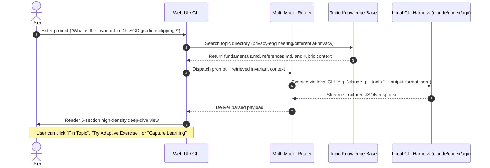
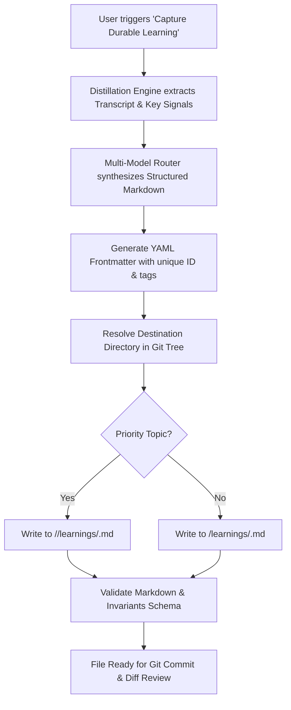
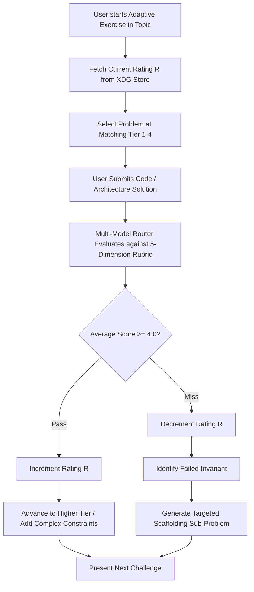
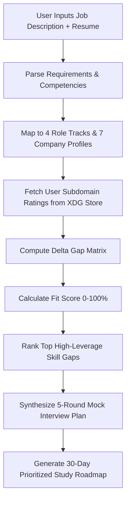

# User Experience (UX) & Competency Specification: Savage-Fred/learn

**Document Version**: 1.0.0  
**Target Milestone**: Milestone 1 (Foundation PR)  
**Author**: Savage-Fred Architecture & UX Subagent  
**Repository**: `Savage-Fred/learn`  
**Classification**: Authoritative UX & Competency Specification  

---

## 1. Executive Summary & Core UX Principles

The `Savage-Fred/learn` platform is an engineering-first, local-first, Tailnet-accessible technical mastery and interview preparation engine. Unlike generic interview prep platforms that focus on rote memorization or surface-level leetcode solutions, `learn` trains candidates for L4–L6 staff-level bars at top-tier AI labs and FAANG companies (OpenAI, Google/GDM, Anthropic, Meta, Databricks, Netflix, Apple).

### 1.1 Core UX Principles
1. **Invariant-Centric Learning**: Every topic, exercise, and interview is rooted in axiomatic invariants (mathematical proofs, memory hierarchy models, trust boundaries, privacy definitions) rather than superficial syntax.
2. **Zero-Latency Engineering Density**: Clean, fast, dark-mode terminal/IDE aesthetic. Information is presented with high signal density, code snippets, mathematical notation, and formal citations.
3. **Adaptive Cognitive Pressure**: Exercises and interviews dynamically scale difficulty based on continuous performance measurement, stepping candidates up to ambiguous, multi-variable constraints upon demonstrated mastery, or providing targeted scaffolding upon failure.
4. **Durable Knowledge Crystallization**: Exploratory "rabbit holes" and interview debriefs are distilled on-demand into git-versioned, citable markdown files committed directly to the topic knowledge base.
5. **Absolute Privacy of User Performance**: All personal user evaluations, transcripts, proficiency ratings, and resumes are strictly isolated in an out-of-git XDG data directory (`$LEARN_DATA_DIR` / `~/.local/share/learn/`), ensuring zero personal data leaks into git version control.

---

## 2. System Personas & User Journeys

### Persona A: Alex — Mid-Level SWE (L4) Striving for Senior (L5)
- **Profile**: 3 years of backend experience in Go/Python. Strong at standard algorithms (LeetCode Medium), but struggles with ambiguous system design trade-offs, quantitative back-of-the-envelope estimations, and non-trivial distributed failure modes.
- **Primary Goal**: Break through to L5 at Google or Meta. Needs practice articulating CAP trade-offs, designing resilient caching layers (singleflight, thundering herd protection), and solving LeetCode Hard problems with amortized analysis.
- **Typical Journey**:
  1. Opens platform via Tailnet on laptop (`http://will-ubuntu-26.tailacca87.ts.net:8795`).
  2. Runs Role & Resume Alignment against "Meta E5 Software Engineer".
  3. Discovers high-leverage skill gaps in "Master's Algorithms (Network Flow & CHT)" and "Go Scheduler / Concurrency Internals".
  4. Pins both topics to priority dashboard.
  5. Takes an adaptive exercise in Go concurrency; starts at Tier 2 (L4), solves it, and is dynamically stepped up to Tier 3 (L5 Senior) with channel cancellation and zero-leak requirements.
  6. Takes an L5 Mock Interview in "hints" mode with Anthropic or Google calibration, receiving progressive Socratic hints when stuck on dynamic programming state transitions.

### Persona B: Elena — Senior SWE (L5) Aiming for Staff (L6)
- **Profile**: 7 years of distributed systems engineering. Proficient in cloud services, microservices, and database tuning. Struggling to demonstrate the technical breadth, organization-wide failure mitigation, and architectural simplification expected at L6.
- **Primary Goal**: Secure an L6 Staff SWE offer at Databricks or Netflix.
- **Typical Journey**:
  1. Deep-dives on modern authorization invariants: asks "What are Zookies in Google Zanzibar and why are they necessary?"
  2. Platform renders formal mental models, Spanner timestamp proofs, and the New-Enemy problem.
  3. Elena explores edge cases in cross-datacenter snapshot reads, reaching a conceptual breakthrough.
  4. Clicks "Capture as Durable Learning"; the platform distills the exploration into `security/authn-authz/learnings/learn-20261103-zanzibar-zookies.md` with YAML frontmatter.
  5. Launches a 60-minute "no-hints" stress mock interview on "Distributed Storage Engine with Multi-Tenant Isolation". At minute 40, the system initiates adversarial stress probing (network partitions, Byzantine corrupted nodes, 100x traffic spike).
  6. Elena receives a post-interview scorecard showing L6 Staff bar achievement in Systems Architecture and Resilience.

### Persona C: Marcus — Machine Learning Engineer Targeting AI Lab Research Engineer (L4–L5)
- **Profile**: Applied ML background with strong Python and PyTorch skills, but lacking formal low-level systems knowledge (memory hierarchy, GPU streaming, lock-free ring buffers) required for frontier AI lab infra teams (OpenAI, Anthropic).
- **Primary Goal**: Pass OpenAI Research Engineer (non-PhD) coding and systems rounds.
- **Typical Journey**:
  1. Pins "Pythonic Coding Patterns" and "Rust for High-Performance Systems".
  2. Works through Tier 3 and Tier 4 exercises: building an asynchronous streaming tensor batcher and a lock-free IPC ring buffer with atomic sequence numbers.
  3. Enters an OpenAI-calibrated practical coding mock interview that tests live debugging under tight time constraints.

### Persona D: Sarah — Security Architect Targeting Staff Privacy / Security Engineer (L6)
- **Profile**: Enterprise security background, transitioning to frontier AI privacy and agent safety.
- **Primary Goal**: Staff Privacy Engineer at Apple or Staff Security Engineer (Agents & Platform) at OpenAI/Anthropic.
- **Typical Journey**:
  1. Queries invariants for "Modern Differential Privacy: DP-SGD gradient clipping and Moments Accountant".
  2. Practices threat modeling autonomous agents with tool-calling privileges and indirect prompt injection vectors.
  3. Runs an Apple-calibrated L6 Privacy Architecture mock interview focusing on Private Cloud Compute (PCC) remote attestation and zero data retention verification.

---

## 3. Exhaustive Specification of the 6 Core UX Flows

```
+----------------------------------------------------------------------------------------------------+
|                                    6 CORE PLATFORM UX FLOWS                                        |
+----------------------------------------------------------------------------------------------------+
|  1. On-Demand Topic Deep-Dive  --> Invariant extraction, mental models, citable literature         |
|  2. Topic Pinning & Dashboard  --> Priority queue, deadline tracking, urgency indicators          |
|  3. Rabbit-Hole Capture        --> Ad-hoc breakthroughs to git-committed durable markdown          |
|  4. Adaptive Exercise Ladder   --> Dynamic difficulty scaling (Tier 1 -> Tier 4) on pass/miss      |
|  5. Mock Interview Engine      --> Socratic Hints Mode vs. Timed Adversarial Stress Mode            |
|  6. Role & Resume Alignment    --> Job fit scoring (0-100%), gap ranking, tailored 5-round loops   |
+----------------------------------------------------------------------------------------------------+
```

---

### Flow 1: On-Demand Topic Deep-Dive & Invariant Queries

#### 1.1 User Intent & Mental Model
The user encounters an unfamiliar technical concept, an architectural invariant, or an interview question and wants an immediate, mathematically grounded, and citable explanation without fluff.

#### 1.2 Trigger Points
- **Web UI**: Global search/prompt bar (`Cmd+K` or `/` hotkey) with query type `Ask Topic / Invariant`.
- **CLI**: `learn ask "<query>"` (e.g. `learn ask "Why is external consistency required in Zanzibar?"`).
- **MCP Server**: `learn_list_topics` + interactive query tool.

#### 1.3 Step-by-Step Sequence & Transitions


#### 1.4 Structured Response Contract
Every deep-dive response MUST be rendered in 5 structured sections:
1. **Core Mental Model**: 1–2 paragraphs providing the intuitive and axiomatic foundation.
2. **Mathematical / Architectural Invariants**: Preserved truths, equations (LaTeX/KaTeX), or state machine guarantees.
3. **Idiomatic Code / Architectural Pattern**: Production-grade Python/Rust/Go snippet illustrating the pattern with edge-case handling.
4. **Authoritative Citations & References**: Citing academic papers, RFCs, textbooks, or verified interview loops from `references.md`.
5. **Interview Application & Probes**: Specific questions asked at L4, L5, and L6, highlighting what interviewers evaluate.

#### 1.5 Edge Cases & Error Modes
- **Harness Failure / Rate Limit**: Automatically falls back through Tier 1 (`claude` -> `codex` -> `agy`) to Tier 2 (API keys) or Tier 3 (mock/offline). An alert banner displays: `[Harness Fallback Active: Running via Codex gpt-6-astra]`.
- **Ambiguous Query**: If the query matches multiple domains (e.g. "consensus"), the UI presents an instant disambiguation picker: `[Distributed Systems Raft/Paxos]` vs. `[Blockchain Byzantine Consensus]`.

---

### Flow 2: Topic Pinning & Priority Dashboard

#### 2.1 User Intent & Mental Model
The user wants to flag a topic for upcoming interview preparation, track progress against target role gaps, and maintain a prioritized queue of study domains.

#### 2.2 Trigger Points
- **Web UI**: "Pin Topic" button on any topic page or deep-dive result; Priority selector (`High`, `Medium`, `Low`).
- **MCP Tool**: `learn_pin_topic(topic_id="differential-privacy", priority="high", notes="Apple Staff loop prep")`.

#### 2.3 Step-by-Step Sequence & Persistence
1. User triggers pin action with topic identifier, priority level, and optional notes.
2. Platform invokes state manager: reads canonical `$LEARN_DATA_DIR/pinned_topics.json`.
3. Checks if topic is already pinned: updates priority/notes if present; appends new record if not.
4. Returns updated pin record.
5. UI updates Dashboard Sidebar and renders an "Active Priority" badge on the topic card.

#### 2.4 Data Schema (`$LEARN_DATA_DIR/pinned_topics.json`)
```json
[
  {
    "topic_id": "differential-privacy",
    "domain": "privacy-engineering",
    "title": "Modern Differential Privacy",
    "priority": "high",
    "pinned_at": "2026-11-03T06:30:00Z",
    "target_deadline": "2026-12-01T00:00:00Z",
    "notes": "Focus on DP-SGD and RDP composition for Apple Staff Privacy loop",
    "current_rating": 3.8,
    "target_rating": 4.8,
    "status": "in_progress"
  }
]
```

#### 2.5 Invariant Guarantee
Pinning operations modify ONLY the canonical file `$LEARN_DATA_DIR/pinned_topics.json`. Under no circumstance is `pinned_topics.json` written to git, and `git status --porcelain` remains clean.

---

### Flow 3: Rabbit-Hole Capture & Distillation to Durable Markdown

#### 3.1 User Intent & Mental Model
During an exploratory Q&A session, debugging exercise, or post-interview debrief, the user reaches a high-leverage conceptual breakthrough ("aha moment"). Rather than letting this disappear into a ephemeral chat log, the user crystallizes this into a permanent, version-controlled markdown note in the topic's `learnings/` directory.

#### 3.2 Trigger Points
- **Web UI**: "Capture as Durable Learning" button in deep-dive, quiz debrief, or interview review screens.
- **MCP Tool**: `learn_record_durable_learning(topic_id, title, mental_model, invariants, citable_sources, code_examples)`.

#### 3.3 Step-by-Step Distillation Pipeline


#### 3.4 Markdown Artifact Specification (with Frontmatter)
```markdown
---
id: learn-20261103-dp-sgd-moments-accountant-a9f2
title: "DP-SGD Privacy Accounting: Rényi DP vs. Moments Accountant"
topic: differential-privacy
domain: privacy-engineering
target_level: L6
source_trigger: on_demand_deep_dive
invariants_covered:
  - "Per-sample gradient clipping strictly bounds the L2 sensitivity to C"
  - "RDP provides tight linear composition under Gaussian mechanisms"
tags: ["differential-privacy", "dp-sgd", "rdp", "machine-learning", "apple-calibration"]
created_at: "2026-11-03T06:35:00Z"
---

# Executive Summary
Detailed distillation of the mathematical mechanics of DP-SGD...

# Axiomatic Invariants & Proofs
Mathematical formulation of Gaussian noise scale $\sigma \ge \frac{C \sqrt{2 \ln(1.25/\delta)}}{\epsilon}$...

# Production Implementation Pattern
```python
# Working PyTorch per-sample gradient clipping and RDP privacy accounting snippet
```

# Edge Cases & Failure Modes
- Gradient starvation caused by aggressively low clipping threshold $C$.
- Privacy budget explosion under naive advanced composition.

# Interview Application & Calibration
- **L5 Expectation**: Explains why batch clipping violates differential privacy.
- **L6 Expectation**: Proves how Rényi DP converts to $(\epsilon, \delta)$ and implements numerical RDP privacy accounting.

# Primary References
- Abadi et al., *Deep Learning with Differential Privacy* (ACM CCS 2016).
- Mironov, *Rényi Differential Privacy* (IEEE CSF 2017).
```

#### 3.5 Verification Invariant
The resulting file is saved strictly in the designated git-tracked repository directory (`<domain>/<topic>/learnings/` or `<domain>/learnings/`), formatted with valid frontmatter, while zero user scores or personal ratings are embedded.

---

### Flow 4: Adaptive Exercise Progression (Dynamic Difficulty Stepping)

#### 4.1 User Intent & Mental Model
The user wants targeted, interactive practice on a specific topic or competency. The platform serves problems that adapt in real time to the user's capability: succeeding triggers harder, more ambiguous, or distributed constraints; struggling triggers targeted scaffolding and invariant-focused hints.

#### 4.2 The 4-Tier Ladder Architecture
1. **Tier 1 (Starter / Foundational)**:
   - Syntax verification, basic data structures, core invariant validation.
   - Example: Implement a basic token bucket rate limiter in Python; verify single-threaded invariant.
2. **Tier 2 (L4 Mid-Level Benchmark)**:
   - LeetCode Medium equivalent; single-host concurrency or standard 3-tier architecture.
   - Example: Thread-safe token bucket with multi-threaded test harness and TTL expiration.
3. **Tier 3 (L5 Senior Benchmark)**:
   - LeetCode Hard equivalent; distributed failure modes, zero-copy, strict amortized complexity, lock contention mitigation.
   - Example: Distributed sliding-window rate limiter using Redis Lua scripts with clock drift tolerance and network partition handling.
4. **Tier 4 (L6 Staff Benchmark)**:
   - Ambiguous requirements, multi-system cascading trade-offs, catastrophic risk mitigation, zero-downtime reconfiguration.
   - Example: Global multi-region rate limiter handling cross-datacenter WAN partitions, eventual consistency reconciliation, and automated DDoS traffic shedding under degraded network states.

#### 4.3 Dynamic Difficulty Stepping Algorithm
- **User Skill Rating**: Each topic maintains an active skill rating $R \in [1.0, 5.0]$ in `$LEARN_DATA_DIR/user_profile.json` under `subdomain_ratings` (with compatibility fallback in `$LEARN_DATA_DIR/ratings/subdomain_ratings.json`).
- **Turn Evaluation**: The candidate's response is scored across the 5-dimension rubric (Score $S \in [1.0, 5.0]$).
- **Stepping Rule**:
  - **Pass ($S \ge 4.0$)**:
    - Skill rating increments: $R_{new} = \min(5.0, R + 0.3 \cdot (S - 3.5))$.
    - Next exercise steps up a tier ($Tier \to Tier+1$).
    - Constraint Injection: The system introduces harder constraints (e.g. "Now solve in $O(1)$ auxiliary space" or "Assume nodes can experience Byzantine network failures").
  - **Miss ($S < 4.0$)**:
    - Skill rating decrements: $R_{new} = \max(1.0, R - 0.25 \cdot (4.0 - S))$.
    - Difficulty steps down or provides a **Scaffolding Turn**: The engine isolates the exact failed invariant and serves a smaller sub-problem specifically testing that invariant before returning to the main problem.

#### 4.4 Flow Sequence


---

### Flow 5: Full-Scale Mock Interview Engine

#### 5.1 User Intent & Mental Model
The user wants to simulate a real, high-stakes 45–60 minute technical interview round at a target company (e.g. OpenAI Research Engineer Coding, Google L5 Distributed Systems, or Apple L6 Staff Privacy).

#### 5.2 Orthogonal Interview Configuration Dimensions

To satisfy Requirement §R3, the interview engine decouples timing, assistance, and probing into three orthogonal configuration axes, permitting candidates to customize the exact interview simulation required:

```
+----------------------------------------------------------------------------------------------------+
|                                INTERVIEW CONFIGURATION MATRIX                                      |
+----------------------------------------------------------------------------------------------------+
| Axis 1: Timing Mode       --> [timed (45m coding / 60m design)] vs. [untimed (self-paced)]         |
| Axis 2: Assistance Mode   --> [hints (3-tier progressive)] vs. [no-hints (strict simulation)]      |
| Axis 3: Probing Mode      --> [standard follow-ups] vs. [adversarial_stress (100x, partitions)]     |
+----------------------------------------------------------------------------------------------------+
```

All 8 combinations are supported:
- **`untimed + no-hints + standard`**: Self-paced independent practice without timer pressure, solving problems without assistance.
- **`timed + hints + standard`**: Socratic coaching session under realistic FAANG time constraints.
- **`timed + no-hints + adversarial_stress`**: Full-fidelity simulation of an L6 Staff pressure interview.
- **`untimed + hints + standard`**: In-depth guided learning and conceptual scaffolding.

##### Axis 1: Timing Configuration
- **`timed`**: Strictly enforced countdown timer (45 minutes for coding rounds, 60 minutes for systems/architecture). Timer expiry transitions session directly to Phase 5 follow-up debrief.
- **`untimed`**: No countdown clock. Candidate works through requirements, architecture, implementation, and verification at their own pace.

##### Axis 2: Assistance Configuration
- **`hints` (Socratic Coaching)**:
  - **Role of AI**: Acts as an observant, collaborative senior/staff interviewer.
  - **Progressive 3-Level Hints**:
    - **Level 1 (Conceptual Nudge)**: Points to relevant invariant without revealing method.  
      *Example*: "Consider what property of the directed graph changes when traversing a back-edge in DFS."
    - **Level 2 (Structural Direction)**: Suggests algorithmic or architectural pattern.  
      *Example*: "Would maintaining a 3-state coloring (Unvisited, Visiting, Visited) or computing in-degrees for Kahn's algorithm resolve the cycle?"
    - **Level 3 (Concrete Scaffold)**: Provides pseudocode outline or concrete data structure recommendation.  
      *Example*: "Here is the state signature: `def has_cycle(node, visited_states)`. When `visited_states[node] == VISITING`, return True."
  - **Hint Scoring**: Each hint level used is logged and applies a calibrated deduction to the Technical Execution rubric score.
- **`no-hints` (Strict Simulation)**:
  - **Zero Unprompted Assistance**: The AI interviewer provides no hints even if explicitly requested; responds: *"In this simulation mode, work through your assumptions and proceed with your best design."*

##### Axis 3: Probing Configuration
- **`standard`**: Interviewer asks standard technical clarification and follow-up questions during Phase 5.
- **`adversarial_stress`**: The AI interviewer actively probes design limits with catastrophic scenarios:
  - *"Traffic just increased 100x and p99 latency spiked past 2 seconds. Where is your bottleneck and how do you shed load?"*
  - *"The primary database replica suffered silent bit-rot corruption during cross-region failover. How does your reconciliation invariant detect this?"*
  - *"An attacker injects an indirect prompt payload via an external RSS feed. How does your sandbox prevent privilege escalation?"*

#### 5.3 The 5 Standard Interview Phases
1. **Phase 1: Clarification & Requirements Formulation (0–8 min)**:
   - Candidate must ask clarifying questions, define inputs/outputs, throughput ($QPS$), latency targets, and explicit constraints.
2. **Phase 2: High-Level Architecture & Technical Approach (8–18 min)**:
   - Candidate outlines algorithmic strategy or architectural topology, compares alternative approaches, and states core invariants.
3. **Phase 3: Detailed Implementation & Execution (18–35 min)**:
   - Candidate writes complete, compilable, idiomatic code or details component interfaces, schemas, and protocol flows.
4. **Phase 4: Verification, Edge Cases & Complexity Analysis (35–42 min)**:
   - Candidate dry-runs test cases ($0, 1, \infty$, duplicate items, nulls), proves time/space complexity, or analyzes consistency bounds.
5. **Phase 5: Probing, Follow-Ups & Stress Testing (42–50 min)**:
   - Interviewer probes design decisions, injects new constraints, or tests resilience under failure.

#### 5.4 Post-Interview Rubric Scorecard
At the conclusion of the session, the engine generates an authoritative scorecard stored in `$LEARN_DATA_DIR/sessions/<session_id>.json` (with compatibility alias in `$LEARN_DATA_DIR/interviews/transcripts/<session_id>.json`):
- **Overall Hiring Recommendation**: `Strong Hire` | `Hire` | `Lean Hire` | `Lean No Hire` | `No Hire`.
- **Calibrated Level Recommendation**: `L4 Mid` | `L5 Senior` | `L6 Staff`.
- **5-Dimension Rubric Scores**: Graded 1.0 to 5.0 with concrete quotes and transcript references.
- **Identified Strengths**: Verbatim examples of strong engineering signals.
- **High-Leverage Gaps & Remediation Steps**: Direct links to topic directories and tiered exercises to address identified weaknesses.

---

### Flow 6: Role & Resume Alignment

#### 6.1 User Intent & Mental Model
The user provides a target job description (e.g. "Senior Software Engineer - Distributed Systems at OpenAI" or "Staff Privacy Engineer at Apple") alongside their resume markdown. The platform evaluates their fit, ranks high-leverage skill gaps, designs a customized 5-round mock interview loop, and generates a concrete study roadmap.

#### 6.2 Step-by-Step Sequence & Processing


#### 6.3 Fit Scoring Formula
$$\text{Fit Score} = 100 \times \sum_{i=1}^{N} w_i \cdot \min\left(1.0, \frac{R_i}{T_i}\right)$$
Where:
- $w_i$: Weight of competency domain $i$ extracted from job description ($\sum w_i = 1.0$).
- $R_i$: User's current verified proficiency rating in domain $i \in [1.0, 5.0]$.
- $T_i$: Target level expectation for domain $i$ (e.g. L4 = 3.0, L5 = 4.0, L6 = 4.8).

#### 6.4 Output Deliverables
1. **Fit Score Gauge**: Visual percentage (0–100%) with status badge (`Ready for Loop`, `Targeted Gaps Exist`, `Substantial Remediation Needed`).
2. **Gap Matrix**: Interactive comparison table showing Required Level vs. Current Level across all 11 priority topics.
3. **Customized 5-Round Interview Loop**:
   - Round 1: Coding (Language/Idioms) calibrated to company style.
   - Round 2: Algorithmic Rigor or Practical Systems Coding.
   - Round 3: Distributed Systems or Domain Architecture.
   - Round 4: Domain Specialization (Security / Privacy / AI Systems).
   - Round 5: Behavioral / Cultural Alignment & Technical Leadership.
4. **Concrete 30-Day Preparation Plan**: Week-by-week exercise and reading schedule with direct links to repository topic directories.

---

## 4. Target Role Tracks & Company Calibrations

### 4.1 Target Role Track Matrices

| Track ID | Track Name | Seniority Scope | Primary Focus Areas | Required Core Topics |
|---|---|---|---|---|
| **Track 1** | FAANG SWE + AI Lab SWE | L5 (Senior), L6 (Staff) | Distributed systems scale, algorithmic efficiency, high concurrency, clean modular engineering | Pythonic Patterns, Master's Algorithms, Data Structures, Statistics, Go/Rust |
| **Track 2** | FAANG Privacy Engineer + AI Labs | L6 (Staff) | Cryptographic privacy architectures, PETs, regulatory-to-system translation, large-scale data governance | PETs for AI, Differential Privacy, Modern AuthN/AuthZ, Threat Modeling |
| **Track 3** | FAANG + AI Labs Security Engineer | L4 (Mid), L5 (Senior), L6 (Staff) | Threat modeling, cloud security, sandbox escapes, authorization architectures, autonomous agent defense | Modern AuthN/AuthZ, Threat Modeling, Agent Access Models, Rust/Go |
| **Track 4** | AI Lab Research Engineer (non-PhD) | L4 (Mid), L5 (Senior) | High-performance inference runtimes, GPU memory utilization, distributed training plumbing, numeric stability | Pythonic Patterns, Rust, Data Structures, Master's Algorithms, Statistics |

---

### 4.2 The 7 Notable Company Calibrations

> **Grounding & Provenance Notice (§R2)**: Company calibrations and interview loops below are synthesized from authoritative engineering disclosures, public post-mortems, official hiring publications, and verified candidate loop reports. In Milestone 1, specific multi-round loops serve as calibrated practice archetypes; every problem prompt maps directly to a verified source record in the corresponding domain's `references.md`.

#### 1. OpenAI
- **Cultural & Interview Philosophy**: Practical execution speed over academic perfection. Heavy emphasis on real-world systems debugging, agent tooling, inference optimization (KV-cache paging, speculative decoding, FlashAttention), and rapid iteration under pressure.
- **Authoritative Provenance**: OpenAI Triton, GPU cluster architecture disclosures, and verified Research Engineer interview debriefs (2024–2026).
- **Typical 4–5 Round Loop (Calibrated Archetype)**:
  1. Practical Coding Round: 60-min live CLI/harness coding; build streaming batcher or async task queue with live unit tests.
  2. Systems & ML Infrastructure Design: 60-min design of multi-node GPU cluster scheduler or token dispatching layer.
  3. Technical Deep-Dive: 60-min forensic analysis of candidate's past production projects and architectural decisions.
  4. Values, Alignment & Research Empathy: Collaboration, high ownership, safety posture.
- **Disqualifying Anti-Patterns**: Theoretical purity without working code; inability to debug failing tests under time constraints; over-engineering simple problems.

#### 2. Google / Google DeepMind (GDM)
- **Cultural & Interview Philosophy**: Formal algorithmic rigor, asymptotic optimality, mathematical proof of invariants, massive global scale (Spanner, Borg, Zanzibar), clean modular code, and Googleyness.
- **Authoritative Provenance**: Corbett et al. (Spanner, OSDI 2012), Pang et al. (Zanzibar, USENIX ATC 2019), and verified L5/L6 SWE hiring committee rubrics.
- **Typical 4–5 Round Loop (Calibrated Archetype)**:
  1. Algorithmic Coding 1: 45 min, LeetCode Hard, amortized analysis, formal invariant proof.
  2. Algorithmic Coding 2: 45 min, advanced graph algorithms (Tarjan SCC, Network Flow, or 2-SAT).
  3. Distributed Systems Design: 45 min, global consensus, multi-region replication, fault domains.
  4. Googleyness & Leadership: Navigating ambiguity, peer consensus, respectful disagreement.
- **Disqualifying Anti-Patterns**: Hand-waving time/space complexity; sloppy variable naming; ignoring split-brain network partition scenarios.

#### 3. Anthropic
- **Cultural & Interview Philosophy**: Extreme craftsmanship, clean readable code, high safety taste, rigorous threat modeling of agentic systems, sandboxing, and constitutional alignment.
- **Authoritative Provenance**: Anthropic Constitutional AI publications, Model Context Protocol specifications, and systems engineering hiring disclosures (2024–2026).
- **Typical 4–5 Round Loop (Calibrated Archetype)**:
  1. Pair Programming / Take-Home Review: 60 min review and extension of take-home or clean-room implementation of an agent execution engine.
  2. Systems Architecture (Agent / Safety): Design of sandboxed multi-tenant agent execution platform with capability attenuation.
  3. Threat Modeling & Alignment: Red-teaming an autonomous tool-calling agent against prompt injection and SSRF.
  4. Culture & Communication: High empathy, technical humility, clear written communication.
- **Disqualifying Anti-Patterns**: Careless prompt injection risks; excessive ambient privileges; neglecting sandboxing boundaries; defensive reactions to feedback.

#### 4. Meta
- **Cultural & Interview Philosophy**: Speed, volume, and massive social-graph scale (TAO, Cassandra, Memcached). Candidates are expected to write production-ready code with near-zero syntax errors at high velocity.
- **Authoritative Provenance**: Bronson et al. (TAO, USENIX ATC 2013), Meta Engineering disclosures, and E5/E6 candidate calibration matrices.
- **Typical 4–5 Round Loop (Calibrated Archetype)**:
  1. Speed Coding 1: 45 min, 2 distinct LeetCode Medium/Hard problems, fully coded and dry-run tested.
  2. Speed Coding 2: 45 min, 2 additional algorithmic problems.
  3. Product / Systems Architecture (E5/E6): High-throughput caching, graph traversal, back-of-the-envelope calculations ($QPS$, RAM, network bandwidth).
  4. Behavioral / Leadership: Driving cross-team impact, resolving technical disputes.
- **Disqualifying Anti-Patterns**: Running out of time before finishing code; inability to calculate quick back-of-the-envelope numbers; over-complicating architecture.

#### 5. Databricks
- **Cultural & Interview Philosophy**: Low-level systems internals, database storage engines, query execution engines, memory layout, cache-conscious structures, and high-concurrency systems in C++/Rust/Go.
- **Authoritative Provenance**: Armbrust et al. (Delta Lake, VLDB 2020), Photon vectorized engine disclosures, and L5/L6 systems engineering loops.
- **Typical 4–5 Round Loop (Calibrated Archetype)**:
  1. Systems Coding: Implement an in-memory B+ Tree with latch crabbing, or a concurrent lock-free queue with atomic CAS operations.
  2. Storage / Query Engine Design: Design a columnar storage engine (Parquet/Delta) or vectorized query execution pipeline.
  3. Distributed Systems: Raft consensus, distributed transaction management, snapshot isolation.
  4. Culture & Leadership: Intellectual curiosity, customer obsession.
- **Disqualifying Anti-Patterns**: Ignorance of CPU cache lines and memory layout; reliance on heavy garbage collection where zero-copy is required; shallow understanding of atomics.

#### 6. Netflix
- **Cultural & Interview Philosophy**: Freedom & Responsibility; historically distinguished by a senior-first engineering culture, now complemented by structured early-career and new-graduate pathways (Netflix New Grad Program). Extreme emphasis on high autonomy, mature business judgment, microservice resilience, chaos engineering, continuous A/B experimentation, and end-to-end operational ownership.
- **Authoritative Provenance**: Netflix TechBlog (Chaos Monkey, Microservice Architecture), official Netflix Culture Memorandum, and verified Senior SWE loops.
- **Typical 4–5 Round Loop (Calibrated Archetype)**:
  1. System Design (Resilience & Scale): Design a tier-1 streaming or recommendation pipeline with circuit breakers, fallbacks, and multi-region failover.
  2. Technical Strategy & Domain Deep-Dive: Deep exploration of candidate's technical philosophy and architectural decisions.
  3. Experimentation & Data Architecture: A/B testing platforms, CUPED variance reduction, sequential testing.
  4. 2x Culture & Executive Alignment: High independence, mature business judgment, candid constructive feedback.
- **Disqualifying Anti-Patterns**: Needing hand-holding; inability to articulate trade-offs between consistency and user experience; weak operational ownership.

#### 7. Apple
- **Cultural & Interview Philosophy**: Deep on-device efficiency, privacy by design, formal cryptographic attestation (Private Cloud Compute), rigorous differential privacy guarantees for telemetry, and robust systems programming in Swift/Rust/C++.
- **Authoritative Provenance**: Apple Security Engineering & Architecture disclosures (Private Cloud Compute, 2024), Apple Differential Privacy team publications, and ICT4/ICT5 loops.
- **Typical 4–5 Round Loop (Calibrated Archetype)**:
  1. Technical Coding: Memory-constrained systems programming; custom allocators, bit manipulation, or low-level concurrency.
  2. Privacy & Security Architecture: Cryptographic attestation, confidential compute (TEEs), secure enclaves, zero data retention.
  3. Differential Privacy / Domain Deep-Dive: Formal $(\epsilon, \delta)$ privacy budget calculation, DP-SGD, or local differential privacy (LDP).
  4. Cross-Functional Collaboration: Collaboration across hardware, software, and privacy legal teams.
- **Disqualifying Anti-Patterns**: Disregard for battery/memory constraints; treating privacy as an afterthought or compliance checkbox; hand-waving mathematical sensitivity bounds.

---

## 5. The 5-Dimension Evaluation Rubric (L4 vs. L5 vs. L6)

The platform evaluates user mock interview and quiz submissions on a standardized 5-dimension rubric. Each dimension is weighted and scored on a 1.0 to 5.0 scale, directly mapping to level expectations.

```
+----------------------------------------------------------------------------------------------------+
|                                  THE 5 EVALUATION DIMENSIONS                                       |
+----------------------------------------------------------------------------------------------------+
|  1. Problem Decomposition & Invariant Formulation   (Weight: 20%)                                  |
|  2. Technical Execution & Code Craftsmanship        (Weight: 25%)                                  |
|  3. Systems Architecture & Trade-Off Rigor          (Weight: 25%)                                  |
|  4. Resilience, Security & Edge Case Posture        (Weight: 15%)                                  |
|  5. Communication & Calibration Level               (Weight: 15%)                                  |
+----------------------------------------------------------------------------------------------------+
```

### 5.1 Dimension 1: Problem Decomposition & Invariant Formulation (Weight: 20%)
- **Core Signal**: Ability to take an ambiguous, ill-defined prompt, break it into orthogonal sub-problems, and state the preserved mathematical or architectural truths (invariants) that govern the solution.
- **L4 Calibration (Mid-Level, Score 2.5–3.4)**:
  - *Positive Signal*: Identifies standard inputs and outputs; breaks problem into sequential procedural steps; recognizes common algorithmic patterns (e.g. two-pointer, BFS).
  - *Anti-Pattern*: Jumps directly into code before clarifying edge constraints; fails to formulate why an approach is correct.
- **L5 Calibration (Senior, Score 3.5–4.4)**:
  - *Positive Signal*: Explicitly states inductive invariants before writing code (e.g. "At step $i$, the window $[L, R]$ contains at most $K$ distinct elements"); decomposes architecture into decoupled components with clear interfaces.
  - *Anti-Pattern*: Needs interviewer hints to identify non-trivial sub-problems; struggles to decouple data plane from control plane.
- **L6 Calibration (Staff, Score 4.5–5.0)**:
  - *Positive Signal*: Reframes complex problems to eliminate entire classes of failure; derives mathematical invariants that simplify system coordination; identifies the minimal sufficient state required.
  - *Anti-Pattern*: Accepts flawed requirements without challenge; over-engineers complex state machines where simple invariant guarantees suffice.

---

### 5.2 Dimension 2: Technical Execution & Code Craftsmanship (Weight: 25%)
- **Core Signal**: Correctness, idiomatic language use, runtime efficiency, memory footprint, zero-copy optimization, and disciplined handling of boundary conditions.
- **L4 Calibration (Mid-Level, Score 2.5–3.4)**:
  - *Positive Signal*: Produces working, clean code; solves standard LeetCode Medium in 25–30 min; correctly checks $0, 1, \infty$ boundary conditions.
  - *Anti-Pattern*: Sloppy naming conventions; off-by-one errors; inefficient memory allocations (e.g. repeated string concatenation in loops).
- **L5 Calibration (Senior, Score 3.5–4.4)**:
  - *Positive Signal*: Writes production-ready, idiomatic code (Pythonic protocols, Go channel semantics, Rust ownership/borrowing); solves LeetCode Hard in 35–40 min; proves exact asymptotic time and space bounds ($O(N \log K)$).
  - *Anti-Pattern*: Unhandled edge cases requiring interviewer intervention; inability to refactor code cleanly when constraints change.
- **L6 Calibration (Staff, Score 4.5–5.0)**:
  - *Positive Signal*: Writes elegant, minimal, high-performance code; demonstrates acute awareness of cache locality, memory layout, atomic memory ordering, and zero-copy IPC; proactively instruments code for telemetry and observability.
  - *Anti-Pattern*: Disregard for underlying OS/kernel primitives; choosing premature abstractions over transparent, maintainable implementations.

---

### 5.3 Dimension 3: Systems Architecture & Trade-Off Rigor (Weight: 25%)
- **Core Signal**: Ability to design scalable, distributed topologies; articulate conflicting constraints with quantitative metrics; justify trade-offs between consistency, availability, latency, throughput, and financial cost.
- **L4 Calibration (Mid-Level, Score 2.5–3.4)**:
  - *Positive Signal*: Designs standard 3-tier architectures (Client, API Gateway, Services, DB); understands SQL vs. NoSQL trade-offs; implements basic caching (Redis/Memcached).
  - *Anti-Pattern*: Treats components as magical black boxes; unable to explain how a database indexes or shards data.
- **L5 Calibration (Senior, Score 3.5–4.4)**:
  - *Positive Signal*: Designs multi-region distributed systems; articulates quantitative trade-offs (CAP theorem, PACELC, p99 latency vs. throughput); designs cache invalidation strategies (lease-based, write-through, CDC); performs rigorous back-of-the-envelope calculations.
  - *Anti-Pattern*: Hand-waving consensus mechanisms; choosing "eventual consistency" without explaining how conflicts are resolved.
- **L6 Calibration (Staff, Score 4.5–5.0)**:
  - *Positive Signal*: Sets multi-year architectural blueprints; designs systems that gracefully survive complete cloud region outages; articulates deep protocol trade-offs (e.g. gRPC vs. QUIC, LSM-trees vs. B+ trees); accounts for organizational team boundaries (Conway's Law) in service architecture.
  - *Anti-Pattern*: Dogmatic adherence to specific frameworks; failure to quantify total cost of ownership (compute, bandwidth, operational burden).

---

### 5.4 Dimension 4: Resilience, Security & Edge Case Posture (Weight: 15%)
- **Core Signal**: Anticipation of systemic failure modes, threat modeling, defense-in-depth, Byzantine faults, rate limiting, and defensive degradation under attack or overload.
- **L4 Calibration (Mid-Level, Score 2.5–3.4)**:
  - *Positive Signal*: Identifies standard OWASP Top 10 vulnerabilities (SQLi, XSS, CSRF); implements input validation and standard authentication checks; mentions retry logic with exponential backoff.
  - *Anti-Pattern*: Assumes callers are benevolent; ignores retry storms and cascading failures.
- **L5 Calibration (Senior, Score 3.5–4.4)**:
  - *Positive Signal*: Executes systematic threat modeling (STRIDE); designs circuit breakers, dead-letter queues, and load-shedding reverse proxies; architects fine-grained authorization (ReBAC/Zanzibar); accounts for clock skew in distributed leases.
  - *Anti-Pattern*: Neglecting internal trust boundaries; relying on static credentials instead of ephemeral scoped tokens.
- **L6 Calibration (Staff, Score 4.5–5.0)**:
  - *Positive Signal*: Deploys zero-trust architecture across all service tiers; designs sandboxed microVM isolation for untrusted agent workloads; anticipates Byzantine node corruption and split-brain recovery; architects verifiable cryptographic attestation and privacy budget tracking.
  - *Anti-Pattern*: Treating security/privacy as an add-on compliance layer rather than an architectural foundation.

---

### 5.5 Dimension 5: Communication & Calibration Level (Weight: 15%)
- **Core Signal**: Structured, top-down communication (Pyramid Principle), executive presence, concise answers, active listening, and receptive handling of interviewer pushback.
- **L4 Calibration (Mid-Level, Score 2.5–3.4)**:
  - *Positive Signal*: Communicates thought process aloud; asks clarifying questions; receptive to interviewer hints.
  - *Anti-Pattern*: Goes silent for long periods without signaling state; becomes defensive when bugs are pointed out.
- **L5 Calibration (Senior, Score 3.5–4.4)**:
  - *Positive Signal*: Drives the conversation collaboratively; structures discussions into clear phases (Requirements $\to$ Architecture $\to$ Deep-Dive); proactively checks in with interviewer before diving into details.
  - *Anti-Pattern*: Over-communicating trivial details while rushing through high-leverage architectural trade-offs.
- **L6 Calibration (Staff, Score 4.5–5.0)**:
  - *Positive Signal*: Commands executive technical presence; articulates complex trade-offs with extreme clarity and brevity; effortlessly pivots when interviewer alters constraints; synthesizes cross-domain perspectives (business impact, developer velocity, operational reliability).
  - *Anti-Pattern*: Monologuing without reading interviewer cues; inability to summarize architectural decisions in executive terms.

---

## 6. Web UI Information Architecture & Component Hierarchy

The web interface is hosted locally and served over Tailnet (`http://will-ubuntu-26.tailacca87.ts.net:8795`). It adheres to a high-density, dark-mode terminal/IDE design system (monospaced code fonts, subtle borders, high contrast, zero unnecessary animations).

### 6.1 Screen 1: Dashboard & Priority Command Center (`/`)
- **Top Navigation Bar**: Global status pill (`Tailnet: Connected`, `Active Harness: Claude Code CLI`), Quick Search (`Cmd+K`), Pinned Topics counter.
- **Left Sidebar**:
  - Pinned Topics List (draggable priority ordering, urgency indicators, target loop dates).
  - Domain Navigator (`leetcode/`, `system-design/`, `security/`, `privacy-engineering/`).
  - Active Role Track Selector (e.g. `Meta E5 SWE`, `OpenAI Research Eng`).
- **Main Canvas**:
  - **Competency Radar Matrix**: Visual chart comparing user's current ratings (1.0–5.0) against target role benchmarks across the 11 priority topics.
  - **Quick Action Grid**:
    - `[Immediate Topic Deep-Dive]`
    - `[Start Adaptive Quiz Ladder]`
    - `[Launch Full Mock Interview]`
    - `[Analyze Job Description & Resume]`
  - **Recent Transcripts & Durable Captures**: Chronological list of recent markdown notes and scorecards.

---

### 6.2 Screen 2: Topic Explorer & Deep-Dive Arena (`/topics/{topic_slug}`)
- **Split-View Workspace**:
  - **Left Pane (Curriculum & Fundamentals)**: Clean markdown renderer displaying `fundamentals.md`, core invariants, LaTeX equations, and `references.md` citations.
  - **Right Pane (Interactive Console & Q&A)**:
    - Real-time prompt terminal for asking questions and exploring edge cases.
    - Multi-model response viewer with 5-section high-density formatting.
    - Quick action buttons: `[Pin Topic]`, `[Take Tiered Exercise]`, `[Capture as Durable Learning]`.
  - **Durable Capture Modal**:
    - Pre-populates distilled breakthrough title, invariants, and code snippet.
    - Shows destination file path preview (e.g. `system-design/rust/learnings/learn-20261103-atomic-ringbuffer.md`).
    - One-click `[Save to Git Tree]` button.

---

### 6.3 Screen 3: Adaptive Exercise Arena (`/exercises/{exercise_id}`)
- **Header**: Topic badge, Tier indicator (`Tier 1 Starter` $\to$ `Tier 4 Staff`), Active Skill Rating gauge ($R=3.8$).
- **Two-Column IDE Layout**:
  - **Left Pane (Problem Specification)**:
    - Problem description, constraints, and formal invariant requirements.
    - Test case specifications ($0, 1, \infty$ boundary criteria).
  - **Right Pane (Code & Solution Editor)**:
    - Code editor with syntax highlighting (Python, Go, Rust) or Architecture markdown editor.
    - Action buttons: `[Run Local Tests]`, `[Submit for Rubric Evaluation]`.
- **Adaptive Feedback Drawer**:
  - Displays instant rubric score across the 5 dimensions.
  - Shows stepping decision: `[PASSED: Difficulty Stepping to Tier 3 Senior (+0.3 Rating)]` or `[FAILED: Invariant Missed -> Stepping to Scaffolding Sub-Problem]`.

---

### 6.4 Screen 4: Full-Scale Mock Interview Terminal (`/interview/{session_id}`)
- **Top Bar**: Target Company badge (`OpenAI`, `Google`, `Anthropic`), Mode indicator (`Hints Mode` vs. `Timed Stress Mode`), Countdown Timer (`44:12`), Phase tracker (`Phase 1: Requirements` $\to$ `Phase 5: Probing`).
- **Main Split View**:
  - **Left Pane (Interviewer Transcript)**: Chat stream showing interviewer dialogue, Socratic nudges, adversarial probes, and candidate responses.
  - **Right Pane (Candidate Workbench)**:
    - Tab 1: Scratchpad & Requirements notes.
    - Tab 2: Code Editor (live, syntax highlighted).
    - Tab 3: Architecture Diagrammer / ASCII canvas.
- **Controls & Hint Drawer (in `hints` mode)**:
  - `[Request Nudge (Level 1)]`, `[Request Structural Hint (Level 2)]`, `[Request Code Scaffold (Level 3)]`.
  - Badge indicating hint penalty: `Hint count: 1 (-0.2 score deduction)`.
- **Scorecard Modal (Post-Interview)**:
  - Full-screen modal presenting overall Hire/No-Hire calibration, L4/L5/L6 level recommendation, 5-dimension score breakdown, strengths, and high-leverage weaknesses.

---

### 6.5 Screen 5: Role & Resume Alignment Hub (`/alignment`)
- **Input Form**:
  - Text area for pasting raw Job Description or uploading JD file.
  - Resume editor / preview of `$LEARN_DATA_DIR/resumes/active_resume.md`.
  - Target Company & Level selector.
- **Results Dashboard**:
  - **Fit Score Radial Gauge**: 0–100% composite score.
  - **Weakness Ranking Table**: High-leverage gaps sorted by impact on passing the target loop.
  - **Tailored 5-Round Mock Interview Plan**: Specific rounds matched to the target company's loop structure.
  - **30-Day Preparation Schedule**: Week-by-week curriculum mapped directly to repository topic directories.

---


## 7. Out-of-Git Data Directory & Clean Invariant

A central operational requirement of `Savage-Fred/learn` (§R4) is the strict isolation of personal user performance state from Git-versioned curriculum assets.

### 7.1 Path Resolution Hierarchy
The platform locates the personal state directory using the following precedence:
1. `LEARN_DATA_DIR` environment variable (if set).
2. `$XDG_DATA_HOME/learn` (if `XDG_DATA_HOME` is set).
3. `~/.local/share/learn` (standard default).

```python
def resolve_learn_data_dir() -> Path:
    if "LEARN_DATA_DIR" in os.environ:
        return Path(os.environ["LEARN_DATA_DIR"]).expanduser().resolve()
    xdg_data = os.environ.get("XDG_DATA_HOME")
    if xdg_data:
        return (Path(xdg_data) / "learn").expanduser().resolve()
    return (Path.home() / ".local" / "share" / "learn").resolve()
```

### 7.2 Directory Layout & JSON Schemas in `$LEARN_DATA_DIR`

```
$LEARN_DATA_DIR/
├── user_profile.json            # Canonical user profile & subdomain proficiency ratings
├── pinned_topics.json           # Canonical active priority topics and target dates
├── sessions/
│   └── <session_id>.json        # Canonical mock interview & adaptive quiz transcripts
├── resumes/
│   ├── active_resume.md         # Candidate resume in markdown
│   └── alignment_report.json    # Canonical role fit scores, gap rankings, and 5-round loop
└── telemetry/
    └── usage_costs.jsonl        # Turn-by-turn token counts, latency, and estimated costs
```

#### 1. `user_profile.json` (Canonical User Profile & Proficiency Ratings)
```json
{
  "user_id": "will",
  "target_roles": ["faang_swe_l6", "ai_lab_research_l5"],
  "target_companies": ["OpenAI", "Anthropic", "Google"],
  "subdomain_ratings": {
    "pythonic-patterns": 4.5,
    "master-algorithms": 4.2,
    "data-structures": 4.6,
    "authn-authz": 3.8,
    "differential-privacy": 3.5,
    "threat-modeling": 3.9
  },
  "last_updated": "2026-11-03T06:30:00Z"
}
```

#### 2. `pinned_topics.json` (Canonical Priority Queue)
```json
[
  {
    "topic_id": "differential-privacy",
    "domain": "privacy-engineering",
    "title": "Modern Differential Privacy",
    "priority": "high",
    "pinned_at": "2026-11-03T06:30:00Z",
    "target_deadline": "2026-12-01T00:00:00Z",
    "notes": "Focus on DP-SGD and RDP composition for Apple Staff Privacy loop",
    "current_rating": 3.5,
    "target_rating": 4.8,
    "status": "in_progress"
  }
]
```

#### 3. `sessions/<session_id>.json` (Canonical Quiz & Mock Interview Transcripts)
```json
{
  "session_id": "sess-20261103-mock-0182",
  "type": "mock_interview",
  "timing_mode": "timed",
  "duration_minutes": 45,
  "assistance_mode": "hints",
  "hint_count": 1,
  "probing_mode": "standard",
  "role_track": "ai_lab_research_l5",
  "company": "OpenAI",
  "topic": "algorithms",
  "start_time": "2026-11-03T06:00:00Z",
  "end_time": "2026-11-03T06:45:00Z",
  "transcript": [
    {"speaker": "interviewer", "text": "Design a memory-bounded streaming batcher..."},
    {"speaker": "candidate", "text": "I will start by clarifying input throughput and chunk bounds..."}
  ],
  "rubric_scores": {
    "decomposition": 4.5,
    "technical_execution": 4.0,
    "architecture": 4.5,
    "resilience": 4.0,
    "communication": 5.0
  },
  "bar_decision": "Hire"
}
```

#### 4. `resumes/alignment_report.json` (Canonical Role & Resume Gap Analysis)
```json
{
  "user_id": "will",
  "analyzed_at": "2026-11-03T06:30:00Z",
  "target_company": "OpenAI",
  "target_role": "AI Lab Research Engineer L5",
  "fit_score": 82.5,
  "status": "Targeted Gaps Exist",
  "top_skill_gaps": [
    {"topic_id": "differential-privacy", "current": 3.5, "target": 4.5, "weight": 0.3},
    {"topic_id": "rust", "current": 3.2, "target": 4.0, "weight": 0.25}
  ],
  "custom_loop": [
    {"round": 1, "type": "Practical Systems Coding", "focus": "Asynchronous Tensor Batcher"},
    {"round": 2, "type": "Algorithmic Rigor", "focus": "Amortized Streaming Buffer"},
    {"round": 3, "type": "Systems Architecture", "focus": "Distributed GPU Node Ingestion"},
    {"round": 4, "type": "Domain Specialization", "focus": "Differential Privacy & Gradient Sanitization"},
    {"round": 5, "type": "Values & Research Alignment", "focus": "Research velocity & engineering empathy"}
  ]
}
```

#### 5. `telemetry/usage_costs.jsonl` (Canonical Cost & Token Ledger)
```json
{"telemetry_id": "0194e3b1-7a20-7210-9b41-f7619280d001", "timestamp": "2026-11-03T06:45:00.123Z", "provider": "claude", "model": "claude-sonnet-3-7", "execution_tier": "subscription_cli", "input_tokens": 1420, "output_tokens": 380, "cached_tokens": 850, "thinking_tokens": 0, "duration_ms": 2150, "estimated_cost_usd": 0.0, "nominal_value_usd": 0.01524, "success": true, "error_message": null, "workflow_type": "adaptive_quiz"}
```

### 7.3 Git Isolation & Automated Test Verification Invariant
To ensure no personal state ever enters the Git repository:
1. All local state directories (`personal_data/`, `data/`, `user_profile.json`, `pinned_topics.json`, `sessions/`, `resumes/`, `telemetry/`) are explicitly ignored in `.gitignore`.
2. Platform initialization defaults `$LEARN_DATA_DIR` to `~/.local/share/learn`, strictly outside the repository root.
3. Automated test `app/tests/test_foundation.py::test_state_directory_isolation` asserts that state paths resolve outside the repo tree.
4. Clean-tree tests assert that running user workflows results in `git status --porcelain` returning empty output for personal state files.
